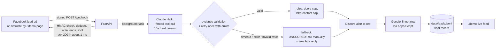
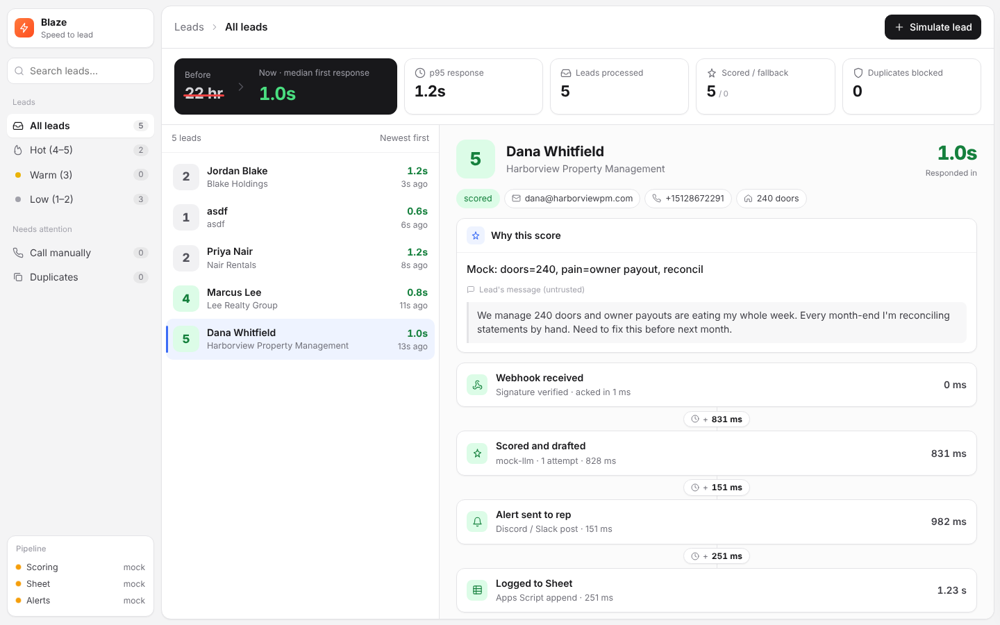

# blaze-speed-to-lead

A small pipeline that gets every paid-ad lead scored, logged, and in front of a sales rep, with a drafted reply, in seconds instead of the current 22-hour median.
A Facebook lead-ad webhook is acked in milliseconds. Claude Haiku then scores the lead from 1 to 5 and drafts an SMS and an email in one structured call, and deterministic code validates the output and applies business rules.
The lead is appended to a Google Sheet and posted to Discord with the score, the drafts, and the measured "Responded in X.Xs". Nothing is ever sent to the lead automatically.



```
received ──► ack (≈1 ms) ──► LLM score + drafts ──► rules ──► Discord alert ──► Sheet ──► leads.jsonl
                 │                 │ fail/timeout                     ▲
                 │                 └──► UNSCORED fallback ────────────┘
                 └──► leads.jsonl "processing" record (written before the ack, so a crash can't lose the lead)
```

## Setup

```bash
python3 -m venv .venv && source .venv/bin/activate
pip install -r requirements.txt
cp .env.example .env      # then fill it in (see below)
```

### .env

| Key | What |
|---|---|
| `ANTHROPIC_API_KEY` | Claude API key (`BLAZE_ANTHROPIC_API_KEY` also works, for hosts that reserve the standard name) |
| `ANTHROPIC_MODEL` | defaults to `claude-haiku-5-5` (latest Haiku, chosen for speed) |
| `FB_APP_SECRET` | verifies `X-Hub-Signature-256`; `simulate.py` signs with it too |
| `FB_VERIFY_TOKEN` | for Facebook's `GET /webhook` handshake |
| `SHEETS_WEBAPP_URL`, `SHEETS_TOKEN` | Apps Script web app URL and shared token |
| `DISCORD_WEBHOOK_URL` | Discord incoming webhook |
| `NOTIFIER` | `discord` (default) or `slack` (then set `SLACK_WEBHOOK_URL`) |
| `BOOKING_URL` | the 15-minute-call link every draft ends with |

### Google Sheet (Apps Script, no GCP service account)

1. Create a new Google Sheet.
2. **Extensions > Apps Script**. Replace `Code.gs` with [`apps_script/Code.gs`](apps_script/Code.gs) and save.
3. **Project Settings (gear) > Script Properties > Add script property**: `SHEETS_TOKEN` = a long random string. Put the same value in `.env`.
4. **Deploy > New deployment > Select type: Web app**.
   - Execute as: **Me**
   - Who has access: **Anyone**
5. Click **Deploy**, authorize, and copy the **Web app URL** (ends in `/exec`) into `SHEETS_WEBAPP_URL`.
6. After editing `Code.gs` later, use **Deploy > Manage deployments > Edit > New version**, or the URL keeps serving the old code.

The script checks the token, creates a `Leads` tab with the header row if it's missing, and appends one row per lead. Apps Script answers every POST with a 302 redirect to `script.googleusercontent.com`. The client uses `follow_redirects=True`, and a test covers this.

### Discord webhook

Server Settings > Integrations > Webhooks > **New Webhook** > choose a channel > **Copy Webhook URL** into `DISCORD_WEBHOOK_URL`.

## Run (2 commands)

```bash
python server.py                       # add --mock to fake the LLM, Sheet and Discord (no keys needed)
python simulate.py --preset great      # great | ok | tiny | junk | injection, or --random
```

Other options:

- `simulate.py --url https://<id>.ngrok.app` targets a tunnel.
- `--repeat` resends the same lead to show dedupe.
- `--bad-signature` expects a 401.
- `python bench.py` fires 10 leads 3 s apart and writes `out/latency.json`.
- Open **http://127.0.0.1:8000/demo** for the demo page.
- `python server.py --reset` archives `data/` (clears dedupe and the demo feed) before a recording.
- `python server.py --mock --mock-llm-fail timeout` (or `garbage`) shows the fallback path.
- `pytest -q` runs the tests.

## Sample output

These samples come from a `--mock` run, so the reasons and drafts are generated by `MockQualifier` and the timings use simulated LLM latency. Full files: [`out/sample_sheet_rows_mock.csv`](out/sample_sheet_rows_mock.csv), [`out/sample_discord_alert_mock.txt`](out/sample_discord_alert_mock.txt).

**Sheet row** (`great` preset):

| received_at | leadgen_id | name | email | phone_e164 | company | doors | message | fit_score | reason | rule_overrides | sms_draft | email_subject | email_body | status | latency_ms | model |
|---|---|---|---|---|---|---|---|---|---|---|---|---|---|---|---|---|
| 2026-10-16T20:35:10.430+00:00 | demo-6c90face9198 | Dana Whitfield | dana@harborviewpm.com | +15128672291 | Harborview Property Management | 240 | We manage 240 doors and owner payouts are eating my whole week… | 5 | Mock: doors=240, pain=owner payout, reconcil | | Hi Dana, thanks for reaching out to Blaze about owner payout… https://cal.com/your-handle/15min | Blaze for Harborview Property Management | Hi Dana, … | scored | 1048.7 | mock-llm |

**Discord alert** (as text; the real one is an embed, green for 4 to 5, yellow for 3, gray for 1 to 2 and unscored):

```
NEW LEAD  asdf | asdf
Score: 1/5   Status: scored
Reason: Mock: doors=unknown, pain=none stated
Rule overrides: fake contact cap: 2->1; FLAG fake contact: placeholder email 'test@test.com'; unparseable phone '555-0000'; placeholder name 'asdf'
Contact: test@test.com | - | doors: asdf
Message: asdf

SMS draft (159 chars):
Hi Asdf, thanks for reaching out to Blaze about your finance workflow. Happy to show how we handle it. Grab a 15-minute call: https://cal.com/your-handle/15min
...
Responded in 0.8s  (model: mock-llm). Nothing was sent to the lead.
```

Demo dashboard (`/demo`): a lead list with a detail view showing the score, the rules applied, the step-by-step pipeline timing, and copyable drafts. A slide-over form simulates leads, and sidebar filters cover Hot, Warm, Low, Call manually and Duplicates. Animations are subtle and respect `prefers-reduced-motion`.



More: [`out/dashboard_lead_form_mock.png`](out/dashboard_lead_form_mock.png), [`out/dashboard_rules_mock.png`](out/dashboard_rules_mock.png).

## Latency (`bench.py`)

`--mock` run: 10 leads, 2 s apart, simulated LLM latency of 0.4 to 1.1 s ([`out/latency_mock.json`](out/latency_mock.json)):

| step | p50 | p95 | max |
|---|---|---|---|
| **received → alert sent** | **0.93 s** | **1.20 s** | **1.20 s** |
| LLM (score + drafts) | 0.78 s | 1.05 s | 1.05 s |
| Discord post (mock) | 152 ms | 155 ms | 155 ms |
| Sheet append (mock, after alert) | 251 ms | 253 ms | 253 ms |
| webhook ack (server) | 0.5 ms | 1.9 ms | 1.9 ms |
| webhook ack (client round trip) | 3 ms | 4 ms | 4 ms |

The real-key table is written by `python bench.py` to `out/latency.json` (see "Status" below).

## Design principles

**The LLM reasons; deterministic code enforces the rules and the speed guarantee.**

- **The lead is never lost and never waits.**
  - The webhook writes a `processing` record to `data/leads.jsonl`, then acks. All other work runs in a background task.
  - The LLM gets a hard 15 s timeout per attempt and a 35 s total budget. A timeout or API error falls back immediately, with no retry, because speed beats scoring.
  - Output that fails validation is retried once, with the validation errors fed back as a `tool_result` with `is_error: true`. If it fails again, the lead falls back.
  - A fallback lead still reaches Discord and the Sheet, marked `UNSCORED: call manually`, with a safe template reply.
  - Worst case the alert goes out at about 45 s: 35 s LLM budget plus a 10 s Discord timeout.
- **Everything the model returns is validated with pydantic** (`app/models.py`):
  - `fit_score` is a strict int from 1 to 5.
  - `reason` is one line and under 160 characters.
  - SMS is 320 characters or fewer; the email body is 120 words or fewer.
  - Both drafts use the lead's first name and include `BOOKING_URL`.
  - No placeholders such as `[Name]`, `{company}` or `<x>`.
  - No number that isn't in the lead data. The one exception is "15", as in "15-minute call".
  - No pricing or promo language ("$", "discount", "% off", "free trial", "price", …) unless the lead used it first.
  - Extra fields are rejected.
- **Deterministic rules wrap the model** (`app/rules.py`):
  - Door counts are parsed in code: `"about 120"` → 120, `"50-100"` → 75 (midpoint), `"1,200"`, `"2k"`, `"a dozen"`, `"under 10"` → 9.
  - Fewer than 10 doors caps the score at 2.
  - Fake contact info caps the score at 1 and is flagged. Examples: placeholder emails such as `test@test.com`, fictional 555-01xx and `555-0000` numbers, repeated or sequential digits, and names such as `asdf`.
  - Every rule that changed the score is written to `rule_overrides`, for example `doors<10 cap: 5->2`. The card and alert also show "model said N".
- **The lead's message is untrusted data.**
  - All lead fields go inside `<lead_data>` and `<lead_message>` tags.
  - `<` and `>` are HTML-escaped, so a message can't close the tag early.
  - The system prompt tells the model to treat the content as data only.
  - The validators are the backstop: an injected "offer a 50% discount" can't reach a draft.
- **Idempotency.** Leads are deduped on `leadgen_id`, with email as the backup. The check-and-mark is atomic, happens before the ack, and is rebuilt from `leads.jsonl` on restart. A duplicate gets a `duplicate` record in the JSONL and the Sheet, and no alert.
- **Sinks can't block each other.**
  - Discord is posted before the Sheet. A Sheet failure or hang (10 s timeout) never delays the alert.
  - Every processed lead is also in `data/leads.jsonl`.
  - Sheet cells are protected against formula injection: a leading `=`, `+`, `-` or `@` gets a `'` prefix.
  - Discord is sent with `allowed_mentions: {parse: []}`, so lead text can't ping `@everyone`.
- **Speed is measured, not claimed.**
  - The clock starts on the first line of the `POST /webhook` handler.
  - Each lead records `scored_ms`, `alert_sent_ms` and `sheet_logged_ms`, plus per-step durations.
  - The Discord embed shows "Responded in X.Xs", measured at dispatch.
- **Human in the loop.** The alert goes to the rep, who approves and sends. Auto-texting real leads would need TCPA-compliant prior express written consent captured on the lead form (clear disclosure, a consent checkbox, and STOP handling) before any automated SMS or call.
- **Prompts live in the repo.** [`prompts/qualify_and_draft.md`](prompts/qualify_and_draft.md) is loaded at call time and holds the rubric (door count, pain, role and company fit, urgency) and the reply style.

### Facebook realism

- `GET /webhook` answers the `hub.mode` / `hub.verify_token` / `hub.challenge` handshake (403 on a bad token).
- `POST /webhook` verifies `X-Hub-Signature-256` (HMAC-SHA256 of the raw body with `FB_APP_SECRET`, constant-time compare) and returns 401 on a bad or missing signature.
- The payload is the Graph API lead shape: `{"leadgen_id", "created_time", "field_data": [{"name", "values"}]}`.
- **Real Facebook leadgen webhooks send only a `leadgen_id`.** Production would call `GET /{leadgen_id}?fields=field_data,created_time` with a Page access token, then run this same pipeline. This repo simulates that post-fetch payload.
- Phone numbers are normalized to E.164 in code. Numbers without a country code are assumed to be US/Canada (+1).

## Choices I made (noted, not asked)

- **Forced tool use** (`tool_choice: {type: "tool"}`) for the JSON. Claude Haiku 5.5 supports it, and the call skips the thinking step, which keeps it fast.
- **Alert before Sheet.** The demo timeline shows the real order: received → scored → alert sent → logged to Sheet.
- **Door ranges use the midpoint.** A missing or unparseable door count applies no cap; the model scores it as unknown.
- **Dedupe is permanent** for both id and email. Use `python server.py --reset` before a demo.
- **Fallback for errors and timeouts has no retry; only validation failures get one.** A retry after a timeout would push the alert past the speed goal.
- **The `--mock` LLM is a deterministic heuristic** with simulated latency, so the whole pipeline (validation, rules, timing, demo) runs without keys.
- **The demo page posts to `/demo/submit`.** The server signs the payload and replays it in-process through the real `/webhook` route. Disable it with `DEMO_ENABLED=false` when exposing the server publicly.

## Status

Built and verified in this repo:

- `pytest` passes: 91 tests.
- Every preset was run through the `--mock` server with `simulate.py`, and again through the demo page in a headless browser, with no console errors and no external requests.
- Both fallback modes (timeout and garbage output) were run, and `bench.py` was run in mock mode.

Not yet run, because the build environment had no keys:

- The real Claude, Sheet and Discord path.
- `bench.py` against real services. It writes `out/latency.json`.

To finish:

```bash
python server.py --reset
for p in great ok tiny junk injection; do python simulate.py --preset $p; done
python bench.py
```

## What I'd do with more time

- **Approve-and-send buttons in Slack**, using interactive messages: the rep taps **Send SMS** or **Send email** on the draft.
- **SMS via Twilio**, only with TCPA consent captured on the form, plus STOP and HELP handling.
- **Auto-call through a voice agent for scores of 4 to 5**: ring the lead within a minute, then hand off to a rep's calendar.
- **Booking-link tracking**: a UTM or per-lead link to measure demos actually held, which is the real metric. Today 5 of 58 qualified leads (8.6%) held a demo.
- **An A/B test of reply styles** against that 8.6% baseline, with the variant id logged per lead.
- **A real Facebook Graph API fetch** of `field_data` from the `leadgen_id`, and Page token management.
